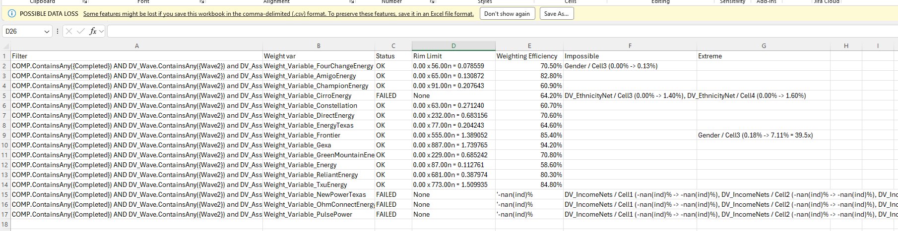

# Wgt-Report-Summary
The script designed to give you a summary of what happened in weighting, in one file. It just grabs outputs from report file and puts it all together.

This could potentially save you a ton of time.

First is when you have a lot of groups - you quickly see which failed and where you need to adjust the rim limit. Also, if there are issues with zeros projected to non-zero, or real respondents projected to zero (that is also causing issues), this is nicely put in front of your eyes. A "Furthest from target" column also shows the biggest percentage-point gaps between the target and what was actually achieved, so non-converging rims stand out immediately.

But even if you have one group only - this is still super helpful, as it prints inconsistencies like zero weighted to non-zero target.

The way it is printed is very readable for project teams, I believe. Gender / Cell 3 (0% -> 0.13%) - this is super clear what the issue is, you don't have to explain why we can't do that.

What you get - see all here on the screenshot. As you see this summary, you don't have to dig into tons of numbers in report, all is printed in easy and readable manner.

So, just run and enjoy.

## Layout

- `src/run_wgt_summary.py` — the script.
- `scripts/` — three ready-made Windows `.bat` examples (see below).
- `tests/` — pytest suite.

## Requirements

- Python 3
- [BeautifulSoup](https://pypi.org/project/beautifulsoup4/) (`bs4`)

Install dependencies with:

```bash
pip install -r requirements.txt
```

## Usage

### Single report

```bash
python src/run_wgt_summary.py --file Weight_Report.htm
```

This writes a `Weight_Report-summary-MM.DD.YYYY.csv` next to the report.

### Many reports into one CSV

When you have one HTML report per market (or any other split), you can append
them all into a single CSV to keep one combined summary:

```bash
python src/run_wgt_summary.py --file Weight_Report_DE.htm --out Weight_Summary.csv --options out_append,out_reportfile_stats
python src/run_wgt_summary.py --file Weight_Report_FR.htm --out Weight_Summary.csv --options out_append,out_reportfile_stats
```

The `--options` flag accepts a comma-separated list of flags:

- `out_append` — append rows to the output CSV instead of overwriting it.
  The header is written only once (when the file is new or empty).
- `out_reportfile_stats` — add two leading columns, `Report File` and
  `Last Edited`, so every row can be traced back to its source report.

The `--furthest-top N` flag (default `3`) controls how many "furthest from
target" rows are listed per filter in the last column.

> The "Furthest from target" column ranks by the residual **percentage-point**
> gap between the target and the achieved output percent. That is a different
> signal from the report's own orange highlight, which flags the *rim weight*
> when it is outside the range "0.1 - 12.0"; the two overlap but are not
> identical.

> To merge reports you must point every run at the **same** `--out` file and
> use `out_append`. Without `--out`, the output name is derived from the input
> file, so each report would get its own CSV.

### Windows `.bat` examples

Three examples live in `scripts/`. Each declares, at the top, a `REPORT_DIR`
(the folder to look in) and a `SCRIPT_PATH` (the path to `run_wgt_summary.py`).
In the repo the script lives under `src\`, so `SCRIPT_PATH` is `..\src\run_wgt_summary.py`;
in a release the `.bat` and `.py` sit side by side, so `SCRIPT_PATH` is just
`run_wgt_summary.py`:

- `run_wgt_summary_single.bat` — process a single report (`REPORT_FILE`).
- `run_wgt_summary_multi.bat` — append several reports, listed explicitly.
- `run_wgt_summary_scan.bat` — scan `REPORT_DIR` for every `Weight_*.htm` and
  append them into one CSV (`OUTPUT_FILENAME`). Its `RECENT_HOURS` cutoff lets
  you process only files edited within the last N hours; leave it blank to
  process all files.

## Build (release folder)

To assemble a runnable `dist/` folder with the script and all wrappers together,
run the build script for your platform:

- macOS / Linux: `bash build.sh`
- Windows: `build.bat`

Both copy `src/run_wgt_summary.py` and every `scripts/run_*.bat` (and `run_*.sh`)
into `dist/`, rewriting each wrapper's `SCRIPT_PATH` so the `.py` is expected in
the same folder. The `.bat` wrappers are normalized to CRLF line endings.

## Development

Run the test suite with:

```bash
pip install -r requirements-dev.txt
python -m pytest
```

See details on the screenshot.


